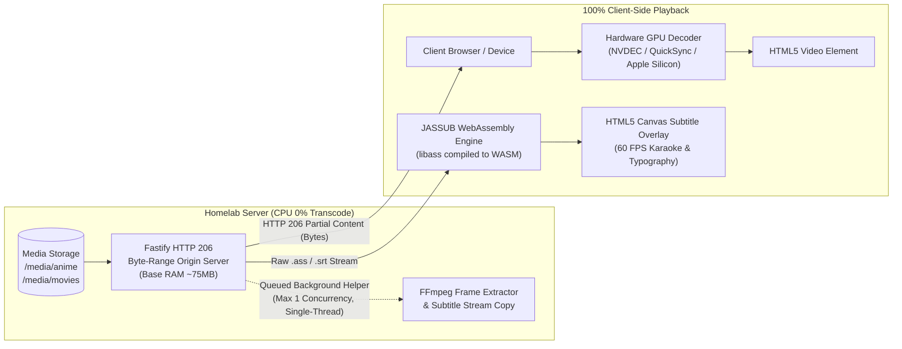

<div align="center">

# StreamVault

**Zero Server-Side Video Transcoding • 100% Client-Side Playback**

A modern self-hosted media streaming origin tailored for personal anime, movie, and TV series collections directly from homelab storage without loading the host CPU.

[](https://nodejs.org/)
[](https://fastify.dev/)
[](https://react.dev/)
[](https://tailwindcss.com/)
[](https://github.com/ThaUnknown/jassub)
[](https://ffmpeg.org/)
[](https://www.docker.com/)
[](LICENSE)

[Architecture](#architecture) • [Features](#features) • [Comparison](#architecture-comparison) • [Preview](#web-interface-preview) • [Tech Stack](#tech-stack) • [Quick Start](#quick-start) • [Safeguards](#operational-safeguards) • [API](#rest-api-endpoints) • [Troubleshooting](#troubleshooting--diagnostics) • [Docs](#documentation)

</div>

---

> **Built for homelab enthusiasts and anime collectors** facing CPU overload and stuttering from traditional media servers. StreamVault offloads 100% of video decoding and stylized ASS/SSA subtitle rendering to client browsers via WebAssembly and RFC 7233 byte-range streaming, keeping server CPU at 0% with sub-75MB base RAM.

---

## Architecture



---

## Features

<table>
  <tr>
    <td width="50%" valign="top">
      <h4>Zero-Transcode Playback & Subtitles</h4>
      <ul>
        <li><strong>Direct HTTP 206 Origin</strong>: Strict RFC 7233 byte-range streaming enables instant seeking (&lt;50ms) without server re-encoding.</li>
        <li><strong>JASSUB WebAssembly Engine</strong>: High-fidelity libass rendering on HTML5 canvas at 60 FPS, preserving anime karaoke, fonts, and vector effects.</li>
        <li><strong>Hardware GPU Decoding</strong>: Client decodes streams locally via NVDEC, Intel QuickSync, or Apple Silicon VideoToolbox.</li>
        <li><strong>Audio & Stream Passthrough</strong>: Direct multi-channel audio delivery and on-demand stream-copy softsub extraction.</li>
      </ul>
    </td>
    <td width="50%" valign="top">
      <h4>Media Management & Operations</h4>
      <ul>
        <li><strong>Folder Explorer</strong>: Hierarchical directory navigation with Grid, Compact, and Details Table view modes.</li>
        <li><strong>3-Mode Folder Thumbnails</strong>: Flexible cover resolution supporting Auto (first video frame), Custom upload, or None.</li>
        <li><strong>Guarded Subprocess Helpers</strong>: Concurrency-limited (max 1) FFmpeg snapshot workers with 15s hard timeouts and circuit breakers.</li>
        <li><strong>Jellyfin-Style Auth & OIDC</strong>: Salted scrypt hashing, stateless HMAC tokens, and turnkey OpenID Connect integration.</li>
      </ul>
    </td>
  </tr>
</table>

---

## Architecture Comparison

| Feature | Standard Plex / Emby | Jellyfin (Burn-in ASS) | StreamVault |
|---|---|---|---|
| **Server CPU During Playback** | 50% - 100% (Transcoding) | 60% - 100% (Burn-in Transcode) | **0.0% (Direct Play Only)** |
| **Server Base Memory Usage** | 400 MB - 1 GB+ | 300 MB - 800 MB | **~75 MB (512 MB Container Limit)** |
| **Subprocess Resource Guard** | None | Configurable | **Queue Limiter + 15s Timeout + Circuit Breaker** |
| **Anime Subtitle Quality (.ass)** | Downscaled or dropped styles | Burned-in, rasterized text | **Native 1080p/4K Canvas (WASM)** |
| **Karaoke & Custom Typography** | Often lost | Limited | **100% Accurate (libass engine)** |
| **Video Seeking Latency** | High (buffer re-transcode) | High (buffer re-transcode) | **Instant (&lt;50ms via Byte-Range)** |
| **Playback State Persistence** | Cloud / Database overhead | Local database queries | **Instant LocalStorage sync** |

---

## Web Interface Preview

### Media Catalog

*Modern dark media catalog featuring continue watching, series grouping, category filters, and live server resource monitoring.*

### Folder Explorer

*Jellyfin and Windows Explorer-style directory browsing with multiple view modes (Grid, Compact, and Details Table).*

### 3-Mode Folder Thumbnail Customizer

*Interactive cover customization supporting Auto (frame extraction from contained video), Custom (image upload), and None (default folder icon).*

### Unique Video Thumbnails & File View

*Fast native video thumbnail generation via FFmpeg with SHA-256 disk caching, badge indicators for ASS subtitles, and direct video streaming.*

### Authentication & Single Sign-On (OIDC Ready)

*Jellyfin-inspired authentication system with scrypt password hashing, session tokens, and built-in OIDC/SSO integration readiness.*

---

## Tech Stack

| Layer | Technology | Role |
|---|---|---|
| **Backend Core** | [Fastify](https://fastify.dev/) 5.1 (Node.js 20+) | High-throughput RFC 7233 HTTP 206 byte-range streaming origin |
| **Subprocess Helpers** | [FFmpeg](https://ffmpeg.org/) / FFprobe | Guarded, queue-limited thumbnail frame extraction & softsub copy |
| **Frontend UI** | [React](https://react.dev/) 18, [Vite](https://vitejs.dev/), [Tailwind CSS](https://tailwindcss.com/) | Responsive dark UI with multi-view file browsing |
| **Video Player** | [Artplayer](https://artplayer.org/) 5.4 | Feature-rich HTML5 video playback controls & shortcuts |
| **Subtitle Engine** | [JASSUB](https://github.com/ThaUnknown/jassub) (libass WASM) | 60 FPS client-side canvas subtitle rendering with full typography |
| **Packaging** | [Docker](https://www.docker.com/) / Docker Compose | Multi-stage Alpine container with PID & memory limits |

---

## Quick Start

### Option 1: Docker Deployment (Recommended)

1. Clone repository and start container:
```bash
git clone https://github.com/samsmon/stream-vault.git
cd stream-vault
docker compose up -d --build
```

2. Access the web interface at `http://localhost:8090` (default credentials: `admin` / `admin`).

#### Homelab Storage Mounting (`docker-compose.yml`)

```yaml
services:
  stream-vault:
    build: .
    container_name: stream-vault
    restart: unless-stopped
    ports:
      - "8090:8090"
    environment:
      - MEDIA_ROOT=/media
      - PORT=8090
      - AUTH_ENABLED=true
      - FFMPEG_MAX_CONCURRENCY=1
    volumes:
      - /mnt/storage/media:/media:ro      # Mount media read-only (:ro)
      - stream-vault-cache:/app/.cache   # Cached thumbnails & subtitles
      - stream-vault-data:/app/data      # User database & folder configs
    deploy:
      resources:
        limits:
          memory: 512M
          pids: 100
        reservations:
          memory: 128M
```

> **Security Note**: Mount media drives with `:ro` (read-only) to guarantee StreamVault cannot modify or delete original files.

---

### Option 2: Local Development (Bare Node.js)

**Prerequisites**: Node.js 20+, FFmpeg installed on host PATH.

```bash
# 1. Install dependencies for root, server, and client
npm run install:all

# 2. Build client assets
npm run build:client

# 3. Start Fastify server
npm start
```

For hot-reload development: run `npm run server:dev` and `npm run client:dev` in separate terminals.

---

## Operational Safeguards

StreamVault implements multi-layered protections against resource exhaustion on low-power homelab servers:

| Safeguard | Configuration | Protection Mechanism |
|---|---|---|
| **Process Queue** | `FFMPEG_MAX_CONCURRENCY=1` | Limits active FFmpeg helper tasks to 1, preventing CPU and memory spikes. |
| **Execution Timeout** | `FFMPEG_TIMEOUT_MS=15000` | Kills hung subprocesses via `SIGKILL` after 15 seconds. |
| **Low-Memory Guard** | `< 45MB RAM remaining` | Halts subprocess spawning dynamically when available memory is critically low. |
| **Optimized Decoder** | `-threads 1 -sn -an -dn` | Single-threaded decoding, suppressing subtitle/audio parsing during thumbnail extraction. |
| **Circuit Breaker** | SHA-256 Negative Caching | Permanently blacklists corrupt media files with fallback SVG, preventing retry loops. |
| **Kernel Shield** | `pids_limit: 100` & `init: true` | Prevents fork bombs and zombie process accumulation inside container. |

---

## REST API Endpoints

| Method | Endpoint | Description |
|---|---|---|
| `GET` | `/api/health` | Service health, memory metrics, queue status, and uptime |
| `POST` | `/api/auth/login` | Authenticate with username and password; returns session token |
| `GET` | `/api/browse?subpath=...` | Hierarchical directory and file listing with metadata |
| `GET` | `/api/stream?path=...` | RFC 7233 HTTP 206 partial content video byte stream |
| `GET` | `/api/thumbnail?path=...` | Guarded video frame snapshot (SHA-256 disk cached) |
| `GET` | `/api/subtitles?path=...` | Serve companion or extracted subtitle files (`.ass`, `.srt`) |
| `POST` | `/api/folders/thumbnail` | Update folder cover mode (`auto`, `custom`, `none`) |

---

## Player Keyboard Shortcuts

| Shortcut | Action | Shortcut | Action |
|---|---|---|---|
| `Space` | Play / Pause | `F` | Toggle fullscreen |
| `J` / `Left` | Seek backward 10s / 5s | `M` | Mute / Unmute audio |
| `L` / `Right` | Seek forward 10s / 5s | `C` | Subtitle selection menu |
| `Up` / `Down` | Volume ±10% | `N` / `P` | Next / Previous episode |

---

## Troubleshooting & Diagnostics

| Symptom | Probable Cause | Immediate Remediation |
|---|---|---|
| `HTTP 416 Range Not Satisfiable` | Malformed range header or truncated file | Verify client player headers and inspect media file integrity. |
| `Thumbnail extraction timeout` | Corrupted keyframe or unreadable stream | Guard worker triggers circuit breaker, returning negative SVG cache automatically. |
| `Container OOM-kill (Exit 137)` | Memory spike from unconstrained child tasks | Ensure `FFMPEG_MAX_CONCURRENCY=1` and container memory limit is at least 512MB. |
| `Subtitles not rendering` | Missing font attachments or complex ASS | Client-side JASSUB falls back to default sans-serif font without dropping frames. |
| `Port 8090 already in use` | Collision with another homelab service | Change `PORT=8090` and docker host port mapping in `.env` / `docker-compose.yml`. |

---

## Documentation

For homelab deployment guidelines and operational runbooks, see the modular guides in `docs/`:

| Document | Purpose | Target Audience |
|---|---|---|
| [Homelab Service Spec](docs/services.md) | Container topology, Proxmox LXC setup, and operational runbook | Homelab Administrators & SRE |
| [Services Inventory](docs/services.md#📋-ikhtisar-layanan) | Port allocations, volume mappings, and environment variables | DevOps & Sysadmins |

---

## License

Distributed under the [MIT License](LICENSE).
